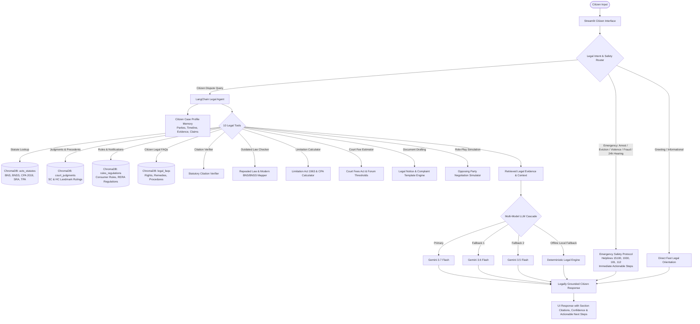

# Juris: AI Legal Assistant for Indian Citizens

> **An empathetic, legally grounded AI assistant that helps ordinary Indian citizens understand and act on everyday legal problems under Indian law — with multi-collection hybrid RAG, structured case building, statutory citation verification, legal document drafting, and emergency escalation.**

[](https://www.python.org/)
[](https://streamlit.io/)
[](https://www.langchain.com/)
[](https://ai.google.dev/)
[](https://www.trychroma.com/)
[](LICENSE)

---

## 📖 Overview

**Juris** is an AI legal assistant specifically engineered to bridge the justice gap for ordinary Indian citizens. Everyday disputes — unreturned tenancy security deposits, consumer refunds, salary withholding, builder delays under RERA, cheque dishonour under Section 138 NI Act, or unfair contract terms — often leave citizens confused by complex legal jargon, high advocate retainers, and opaque court procedures.

Juris transforms unstructured, emotional problem narratives into structured legal cases, explains applicable statutory provisions and judicial precedents in plain English, calculates limitation periods and court fees, drafts formal legal notices and complaints, allows citizens to practice negotiations against a simulated opposing party, and immediately escalates urgent legal emergencies (imminent arrest, unlawful eviction, domestic violence, cyber financial fraud, or hearings within 24 hours).

---

## ⚖️ Core Capabilities

### 1. Conversational Case Building & Fact Extraction
- **Unstructured Intake**: Citizens can explain their grievance in everyday language without needing legal terms.
- **Structured Fact Extraction**: Automatically identifies and extracts:
  - Parties (Aggrieved citizen vs. Opposing party/organization)
  - Key incident dates, limitation anchors, and notices sent
  - Disputed amounts, damages, and security deposits
  - Physical or digital evidence available (agreements, receipts, WhatsApp chats, bank statements)
  - Applicable jurisdiction (state, city, appropriate forum)
- **Chronological Timeline**: Constructs an editable chronological event timeline.
- **Missing Information Detection**: Highlights missing facts (e.g., date of written demand, lease expiry date, transaction IDs) and prompts the citizen with relevant follow-ups.
- **Isolated User Case Vault**: Secure, user-isolated disk storage (`data/user_cases/{user_id}/`) ensuring case data never leaks across users.

### 2. Legal Understanding & Anti-Hallucination
- **Plain-English Explanations**: Breaks down complex legal rights, remedies, and defenses into clear, actionable steps.
- **Multi-Collection Statutory Grounding**: Retrieves exact statutory provisions, regulations, and High Court / Supreme Court precedents from ChromaDB.
- **Strict Anti-Hallucination Guardrails**:
  - Distinguishes binding statutory text from judicial interpretation and explanatory FAQs.
  - Automatically identifies repealed laws and flags modern replacements (e.g., IPC 1860 → BNS 2023, CrPC 1973 → BNSS 2023, Indian Evidence Act 1872 → BSA 2023, Consumer Protection Act 1986 → 2019).
  - Verifies citations against official Indian law schedules; never fabricates sections, judgments, or quotations.
  - Checks territorial and pecuniary jurisdiction (e.g., Consumer Forum thresholds: District Commission up to ₹50 Lakh, State Commission ₹50 Lakh–₹2 Crore, NCDRC > ₹2 Crore).
  - Explicitly admits when evidence is insufficient rather than guessing.

### 3. Legal Document Generation
Generates legally formatted, downloadable, and editable drafts populated with extracted case facts:
- **Formal Legal Notices**: Statutory demand notices (e.g., refund of security deposit with interest, salary demand with 15-day compliance window, Section 138 NI Act demand).
- **Consumer Complaints**: Consumer forum complaints under Section 35 of the Consumer Protection Act 2019 (District Consumer Disputes Redressal Commission).
- **Replies to Legal Notices**: Formal rebuttals refuting baseless allegations and asserting counter-claims.
- **RTI Applications & Formal Representations**: RTI queries under Section 6(1) of the RTI Act 2005, representations to labor commissioners, and police complaints under Section 173 BNSS.

### 4. Negotiation & Argument Practice (Opposing Party Simulator)
- Simulates the opposing party (e.g., defensive landlord claiming wear-and-tear deductions, corporate consumer grievance desk quoting return policies, or defaulting employer alleging project delays).
- Challenges the user's claims, raises realistic objections, and tests the citizen's evidence.
- Provides constructive feedback on legal strengths, weak points, and negotiation leverage.

### 5. Emergency Safety Bypass & Immediate Escalation
Directly intercepts high-stakes emergencies without conversational delay:
- **Imminent Arrest or Police Summons**: Invokes Article 22(1) Constitution of India, Section 41A/47 BNSS (D.K. Basu guidelines), right to legal counsel, and NALSA Free Legal Aid (15100).
- **Unlawful Eviction / Dispossession**: Advises on Section 6 Specific Relief Act 1963, police assistance (112), and urgent interim injunction procedures.
- **Domestic Violence / Immediate Threat**: Connects immediately to the National Emergency Helpline (112), Women Helpline (181), and Section 12 PWDVA 2005 protections.
- **Cyber Financial Fraud**: Immediate "Golden Hour" protocol — freezing bank accounts via Cyber Crime Helpline (1930) and cybercrime.gov.in.
- **Court Hearing within 24-48 Hours**: Directs to legal counsel, High Court/District Legal Services Authority (DLSA), and explains appearance or adjournment applications.

---

## 📐 System Architecture



---

## 📚 Multi-Collection Legal Knowledge Base

Juris organizes legal knowledge into 4 separate collections within ChromaDB, preventing confusion between binding statutory provisions and explanatory materials:

| Collection Name | Content Type | Source & Scope | Chunking Strategy |
| :--- | :--- | :--- | :--- |
| `acts_statutes` | Official Acts & Sections | Bharatiya Nyaya Sanhita (BNS 2023), Consumer Protection Act 2019, Transfer of Property Act 1882, Specific Relief Act 1963, Negotiable Instruments Act 1881, RTI Act 2005, Real Estate (Regulation and Development) Act 2016 (RERA), Information Technology Act 2000, Limitation Act 1963 | Section-Aware Chunking (`Act → Chapter → Section → Subsection`) with breadcrumb headers |
| `court_judgments` | Judicial Precedents | Supreme Court of India & High Court rulings on tenancy deposits, consumer deficiency in service, salary withholding, and cheque bounces | Case citation, court, judgment date, ratio decidendi, and verified holding |
| `rules_regulations` | Rules & Notifications | Consumer Protection (General) Rules, Central/State Rent Control Rules, RERA notifications | Chapter and Rule-level splitting with gazette effective dates |
| `legal_faqs` | Explanatory Citizen FAQs | Practical citizen FAQs, procedural guidance, forum steps, and rights summaries | Question & Answer pair chunks preserving practical procedural workflows |

---

## 📁 Repository Structure

```
Juris Ai/
│
├── app.py                              # Streamlit citizen-facing application
├── requirements.txt                    # Project dependencies
├── README.md                           # System documentation & architectural reference
├── LICENSE                             # MIT License
├── .env.example                        # Environment variables template
├── .gitignore                          # Git ignore rules
│
├── data/                               # Legal Knowledge Base & Case Storage
│   ├── ingestion_manifest.json         # Knowledge base ingestion manifest & chunk counts
│   ├── user_cases/                     # Secure per-user case storage (isolated on disk)
│   ├── cleaned/                        # Cleaned court judgments (JSONL)
│   ├── raw/                            # Raw legal judgments & statutory PDFs
│   └── sft/                            # Supervised legal fine-tuning & FAQ datasets
│
├── chroma_db/                          # Persistent ChromaDB vector storage (4 collections)
│
├── docs/                               # Architectural & Technical Documentation
│   ├── index.md                        # Documentation overview
│   ├── architecture.md                 # System architecture and data flow
│   ├── rag.md                          # Hybrid RAG & section-aware chunking
│   ├── tools.md                        # Reference guide for all 10 legal tools
│   ├── prompts.md                      # System instructions & anti-hallucination prompts
│   ├── setup.md                        # Local setup & environment configuration
│   └── deployment.md                   # Cloud & container deployment guide
│
├── scripts/                            # CLI Administration & Maintenance Utilities
│   ├── ingest_legal_knowledge_base.py   # Multi-collection legal knowledge base builder
│   ├── verify_legal_knowledge_base.py  # Knowledge base inspection & query benchmark
│   ├── test_runner.py                  # CLI test runner
│   └── clean_database.py               # ChromaDB database wiping utility
│
├── src/                                # Core Application Architecture
│   ├── __init__.py                     # Package initializer
│   ├── config.py                       # AppConfig with 4 legal collections & Gemini settings
│   ├── constants.py                    # Indian legal domains, limitations, helplines & outdated laws
│   ├── agent.py                        # LegalAgent with multi-model fallback & streaming
│   ├── router.py                       # LegalIntentRouter with emergency safety bypass
│   ├── retriever.py                    # Multi-collection hybrid retriever with citation boosting
│   ├── vector_store.py                 # LegalVectorStore with rate-limit batching & retry
│   ├── memory.py                       # CitizenLegalMemory with structured case state
│   ├── prompts.py                      # Anti-hallucination system prompt & draft templates
│   ├── tools.py                        # 10 specialized Indian legal tools
│   ├── splitter.py                     # Section-aware legal text splitter
│   ├── loaders.py                      # Multi-source legal document loaders
│   ├── parser.py                       # Legal text cleaning & section header parser
│   ├── embeddings.py                   # Google Gemini embeddings interface
│   ├── chains.py                       # LCEL RAG chain pipelines
│   ├── logger.py                       # Rotating file logger (juris.log)
│   ├── styles.py                       # SaaS UI stylesheet (light-indigo/lavender theme)
│   └── utils.py                        # Citation formatting & first-person follow-up prompts
│
└── tests/                              # Automated Test Suite
    ├── test_juris_scenarios.py         # 10 mandatory Indian legal scenario evaluations
    ├── test_followup_prompts.py        # First-person prompt format verification
    └── test_token_streaming.py         # Real-time token streaming verification
```

---

## 🛠️ Technology Stack

| Layer | Technology | Description |
| :--- | :--- | :--- |
| **Language** | Python 3.11+ | Backend execution & asynchronous pipelines |
| **User Interface** | Streamlit | Responsive citizen SaaS interface with light-indigo pastel styling |
| **Orchestration** | LangChain Core & Community | Agent execution, LCEL chains, and dynamic tool binding |
| **Primary LLM** | Google Gemini 3.7 Flash | High-speed statutory reasoning, fact extraction & drafting |
| **LLM Fallback Cascade** | Gemini 3.6 Flash / 3.5 Flash | Multi-model fallback cascade with circuit-breaker protection |
| **Deterministic Engine** | Local Rule Engine | Offline legal guidance if all LLM API quotas are exhausted |
| **Embeddings** | Google Gemini Embeddings | High-dimensional semantic vectors (`gemini-embedding-001`) |
| **Vector Store** | ChromaDB Persistent Store | 4 separate collections with L2 cosine similarity metrics |
| **Data Sources** | Legislative Dept, SC/HC, CPA | Official Indian Acts, Supreme Court judgments, and legal FAQs |

---

## 🚀 Installation & Quick Start

### 1. Clone the Repository
```bash
git clone https://github.com/your-username/Juris-Ai.git
cd "Juris Ai"
```

### 2. Set Up Virtual Environment
```bash
python -m venv .venv

# On Windows:
.venv\Scripts\activate

# On macOS/Linux:
source .venv/bin/activate
```

### 3. Install Dependencies
```bash
pip install -r requirements.txt
```

### 4. Configure Environment Variables
Copy `.env.example` to `.env` and insert your Google Gemini API key:
```bash
cp .env.example .env
```
Inside `.env`:
```env
GOOGLE_API_KEY=your_gemini_api_key_here
LOG_LEVEL=INFO
```

### 5. Ingest Legal Knowledge Base
Ingest the 4 official legal collections into ChromaDB:
```bash
python scripts/ingest_legal_knowledge_base.py
```

### 6. Launch the Application
```bash
streamlit run app.py
```
Open your browser at `http://localhost:8501`.

---

## 🧪 Testing & Evaluation Scenarios

Juris includes an automated evaluation suite testing **10 core Indian legal scenarios**:

```bash
python tests/test_juris_scenarios.py
```

### Evaluated Scenarios:
1. **Tenancy Dispute**: Landlord withholding ₹75,000 security deposit citing normal wear-and-tear; checks statutory notice steps and legal remedies under Delhi/State Rent Control Acts and Transfer of Property Act 1882.
2. **Consumer Refund**: E-commerce / manufacturer refusing refund for a defective laptop; tests Consumer Protection Act 2019, Section 35 complaint procedure, and limitation periods.
3. **Salary Withholding**: Employer unpaid salary of ₹1.5 Lakh for 3 months; tests Section 15 Payment of Wages Act 1936, Industrial Disputes Act 1947, and formal legal notice drafting.
4. **Fabricated Legal Section**: User asks about non-existent "Section 999 of the Indian Contract Act 1872"; verifies strict anti-hallucination refusal and citation verification.
5. **Outdated / Repealed Statute**: User asks about Section 420 IPC 1860; verifies detection of repeal and mapping to modern Section 318(4) Bharatiya Nyaya Sanhita (BNS 2023).
6. **Incorrect Jurisdiction**: Filing a ₹5 Crore consumer claim in the District Commission; tests pecuniary threshold correction (District Commission is up to ₹50 Lakh under CPA 2019; ₹5 Crore must be filed before the National Commission - NCDRC).
7. **Contradictory Facts & Dates**: User claims an agreement signed on June 1, 2024, but dispute occurred in 2022; verifies timeline contradiction detection and clarification request.
8. **Insufficient Evidence**: Citizen alleges builder delay without agreement or payment receipts; tests identification of missing evidence before legal action.
9. **Urgent Court Notice**: Citizen receives notice for a hearing tomorrow; verifies immediate emergency escalation, DLSA legal aid referral, and adjournment application advice.
10. **Legal Notice Generation**: Tests end-to-end legal notice drafting with extracted case facts, statutory demand, and 15-day compliance window.

---

## 🛡️ Ethical & Legal Guardrails

- **Informational Tool Disclaimer**: Juris is an AI-powered legal education, fact-organization, and document-drafting assistant. It is **not** an enrolled advocate and does not provide formal legal representation.
- **Bar Council of India Compliance**: Juris clearly disclaims advocate-client privilege and does not solicit legal business.
- **Lawyer Consultation Recommendation**: Juris explicitly advises consulting a qualified advocate for complex disputes, litigation, court representation, and criminal defense.
- **Emergency Protection**: Immediate crisis intervention with national helplines for domestic violence, police intimidation, illegal eviction, and cyber fraud.
